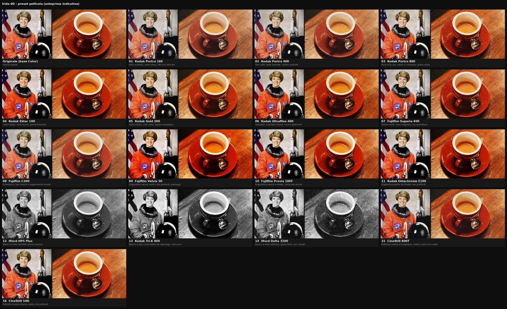

# Preset pellicola per LightCraft e Lightroom

Il "look" di un rullino Iride (Stile Foto, contrasto, saturazione, tonalità) la 6D lo applica **solo al JPEG** e all'anteprima dentro il CR2.
LightCraft e Lightroom mostrano prima quell'anteprima e poi sviluppano il RAW con le loro impostazioni: il look sparisce.

Questi 16 preset (uno per pellicola, stessi nomi del firmware) danno il carattere della pellicola **al RAW**.

| File | Contenuto |
|---|---|
| `xmp/*.xmp` | i preset, formato XMP di Lightroom (`crs:`) |
| `films.py` | i valori di ogni pellicola |
| `make_presets.py` | genera gli XMP e lo zip: `python3 make_presets.py out` |
| `preview.py` | anteprima **indicativa** (approssima i cursori, non è il motore di LightCraft) |

## Importare

- **LightCraft**: pannello Presets (`Shift`+`P`) → **Import Presets…** → scegli lo zip o i file `.xmp`. Compaiono nel gruppo *Iride 6D - Pellicole*.
- **Lightroom Classic / Lightroom**: pannello Predefiniti → `+` → **Importa predefiniti** → zip o `.xmp`.

## Usare

1. Le foto di un rullino hanno il prefisso `Rnnn` (es. `R0110017.CR2` = rullino 11): selezionale tutte.
2. Applica il preset della pellicola del rullino (il registro `ML/LOGS/IRIDE.CSV` dice quale era).
3. Il bilanciamento del bianco non viene toccato: la temperatura della pellicola è già nel RAW ("As Shot").

Ogni preset scrive lo stesso gruppo di cursori: passando da una pellicola all'altra non restano residui della precedente.
Con il cursore *Amount* (LightCraft 0–200 %, Lightroom 0–200) si dosa l'effetto.

I valori sono un'interpretazione del carattere di ogni pellicola, non una misura di laboratorio.
I nomi delle pellicole servono solo a descriverne lo stile; i marchi appartengono ai rispettivi proprietari.
